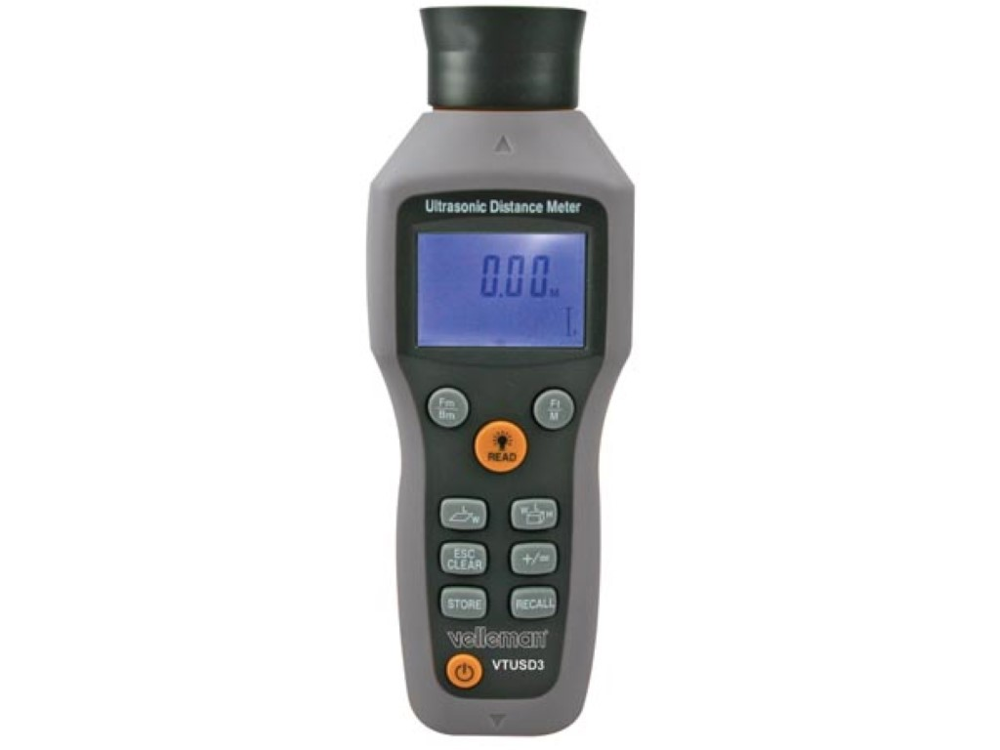
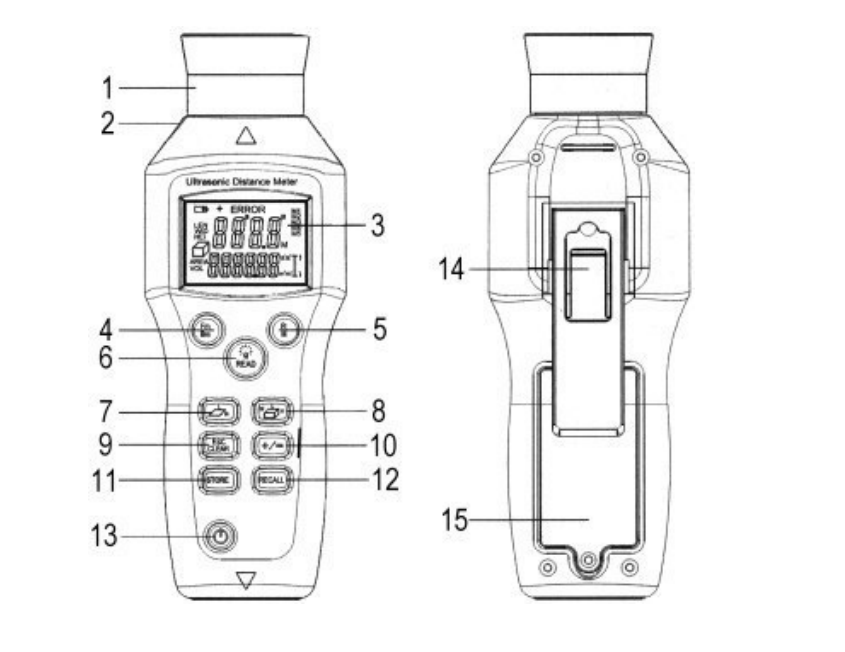
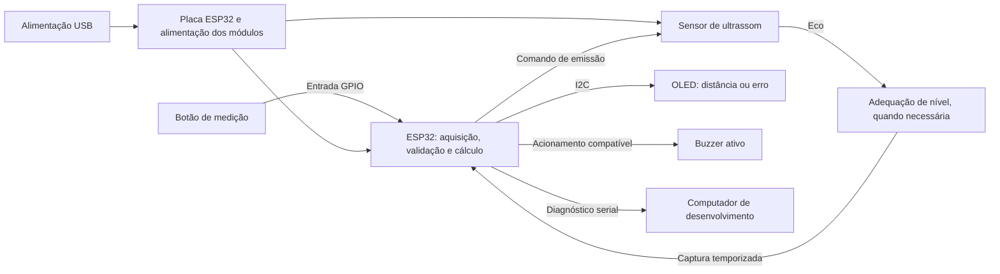
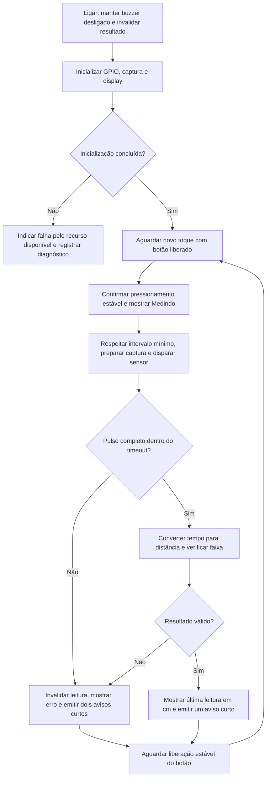

# Velleman VTUSD3 — estudo técnico e proposta de reprodução com ESP32

**Trabalho 2 — 2026/2**  
**Produto selecionado:** Velleman VTUSD3, medidor ultrassônico de distância com apontador laser.  
**Situação:** relatório em revisão; descrição, figuras, comparação com cinco similares e proposta de reprodução redigidas. Permanecem pendências de identificação do grupo, revisão técnica e consolidação bibliográfica.
**Entrega indicada no enunciado:** 03/11/2026.

> **Nota de edição:** substituir os campos `[PREENCHER]` durante a pesquisa. Para características não identificadas, registrar as fontes consultadas; usar “não se aplica” somente com justificativa. Uma informação da ESP32 não descreve automaticamente o produto comercial.

## Identificação do grupo

| Integrante | Nome completo | Matrícula |
| --- | --- | --- |
| 1 | [PREENCHER] | [PREENCHER] |
| 2 | [PREENCHER] | [PREENCHER] |
| 3 | [PREENCHER] | [PREENCHER] |
| 4 | [PREENCHER] | [PREENCHER] |

## 1. Objetivos

Este trabalho tem como objetivo realizar um estudo teórico do medidor de distância Velleman VTUSD3, identificando suas principais funções e a sua arquitetura de hardware e software. A partir dessa análise, propõe-se um modelo conceitual para a reprodução parcial do dispositivo utilizando um microcontrolador ESP32 e um sensor ultrassônico. O foco acadêmico é implementar o cálculo de distância por tempo de eco acústico sob solicitação do usuário, validar os dados em interface visual e sonora, e aplicar conceitos de temporização, controle de portas GPIO e desenvolvimento de firmware.
## 2. Seleção do sistema embarcado

O **Velleman VTUSD3** foi escolhido por ser um sistema embarcado dedicado de instrumentação que integra sensoriamento acústico, atuação óptica/visual e processamento digital em um dispositivo portátil [R1, R2]. 

A escolha se justifica por quatro pontos principais:
* **Documentação acessível:** O manual oficial detalha todas as funções, modos de operação, especificações técnicas e limitações físicas do aparelho [R2].
* **Compatibilidade com o laboratório:** O núcleo funcional do produto pode ser reproduzido com a ESP32 e módulos básicos da lista da disciplina (sensor ultrassônico, botão, display OLED I²C e buzzer ativo).
* **Viabilidade para o grupo:** A arquitetura modular viabiliza a prototipagem em protoboard aplicando técnicas de laboratório, permitindo que a equipe desenvolva o projeto integralmente sem equipamentos comerciais e concentre os esforços na integração de hardware e na precisão do firmware.
* **Escopo bem definido:** Permite estudar na prática leitura de sensores, captura temporizada em microssegundos, comunicação I²C e tratamento de erros de medição.

## 3. Estudo do produto e proposta

### 3.1 Descrição do produto selecionado

#### 3.1.1 Visão geral e funções principais

O **Velleman VTUSD3** (*Ultrasonic Distance Meter*) é uma trena digital portátil comercializada pela Velleman que mede distâncias de 0,50 m a 16 m, com precisão declarada de ±1% + 1 dígito e tempo de resposta de 2 s [R1, R2, seção 8].

A medição de distância é feita exclusivamente por ondas ultrassônicas. O laser integrado (Classe 2, 650 nm, < 1 mW) serve apenas como apontador visual para indicar o local mirado. Por isso, o aparelho não consegue medir através de vidros: o laser atravessa a vidraça, mas o som reflete nela [R2, seções 2, 7 e 8].

**Critério de fonte:** adota-se o manual versão 03 [R2](#r2) para as especificações. A página comercial [R1](#r1) informa 670 nm para o laser, enquanto o manual informa 650 nm; também há divergências de dimensões e massa. Sem identificação de revisão de hardware, esses valores não foram combinados nem interpretados como prova de versões diferentes.

Suas funções principais documentadas são [R2, seções 4 e 6]:
- **Medição de distância (`READ`):** Emite o pulso ultrassônico e exibe a distância até o alvo no visor LCD.
- **Seleção de referência (`Fm/Bm`):** Alterna a origem da medida entre a parte frontal (`Fm`, referência frontal do aparelho) e a base traseira do aparelho (`Bm`, para medições de parede a parede).
- **Conversão de unidades (`Ft/M`):** Alterna as leituras entre metros (m, m² e m³) e pés (ft, ft² e ft³).
- **Cálculo de área e volume:** Calcula automaticamente a área (L x W) ou o volume (L x W x H) de um cômodo a partir de duas ou três medições sequenciais.
- **Soma de distâncias (`+`):** Acumula várias medições seguidas até o limite de 100 m ou 100 ft.
- **Memória (`STORE` / `RECALL` / `ESC/CLEAR`):** Armazena até 5 conjuntos de medidas. Um toque curto em `ESC/CLEAR` limpa a tela; manter pressionado por 3 s apaga toda a memória.
- **Economia de energia:** Desliga a luz de fundo do visor após ± 5 s e o aparelho após ± 1 min de inatividade.
  
#### 3.1.2 Público-alvo, contexto de uso e segmento de mercado

Neste estudo, o VTUSD3 é enquadrado no segmento de **instrumentos portáteis de medição dimensional para uso doméstico, bricolagem (DIY) e serviços prediais leves**. Esse enquadramento é uma análise do grupo a partir das funções de distância, área e volume documentadas no manual; não constitui uma classificação comercial explícita do fabricante [R2](#r2).

- **Público-alvo proposto pelo grupo:** Usuários domésticos, técnicos, instaladores e corretores que precisam levantar dimensões de cômodos. Esses perfis são inferidos das funções disponíveis, não uma lista de usuários divulgada pela Velleman. O termo de garantia caracteriza o aparelho como produto de consumo (*consumer product*), reduzindo a garantia de 24 para 6 meses em caso de uso profissional intenso [R2, p. 32].
- **Contexto de uso e restrições:** Voltado para ambientes internos sob temperaturas de 0°C a 40°C e umidade relativa de 45% a 91%. Como o som sofre influência da temperatura e umidade, o manual recomenda aguardar ± 15 min para o aparelho atingir a temperatura ambiente antes do uso. Exige apontamento em ângulo de 90° contra superfícies planas e largas, apresentando erros em corredores estreitos, sob vento/correntes de ar (acima de 12 m) ou contra materiais que absorvem som, como cortinas [R2, seções 6–8].
- **Aplicações:** O manual documenta o uso para medição entre paredes e levantamento de área e volume de salas [R2, seção 6]. Como possibilidades de uso identificadas pelo grupo, essas dimensões podem apoiar estimativas de piso e pintura e o levantamento geométrico de ambientes. Não substituem verificações específicas de instalação de móveis nem o dimensionamento técnico de climatização.

#### 3.1.3 Fotos, ilustrações e diagramas do produto

As duas figuras permitem reconhecer o aparelho e localizar seus controles. A fotografia mostra a vista frontal; a ilustração do manual acrescenta a vista traseira e identifica 15 elementos externos [R1](#r1), [R2](#r2), p. 2.

*Figura 1 — Vista frontal do VTUSD3: transdutor na extremidade superior, LCD e teclas de operação. Imagem de divulgação da Velleman; referência da página do produto e endereço da imagem oficial em [R1](#r1). Arquivo local: `assets/vtusd3.jpg`.*

*Figura 2 — Diagrama de identificação dos elementos externos e controles do VTUSD3, baseado na página 2 do manual oficial [R2, p. 2 e seção 4]: (1) Sensor ultrassônico; (2) Laser; (3) LCD; (4) Modo Frontal/Base; (5) Conversão Pés/Metros; (6) Tecla READ; (7) Medição de área; (8) Medição de volume; (9) ESC/CLEAR; (10) Soma; (11) STORE; (12) RECALL; (13) Tecla ON/OFF; (14) Clipe de cinto; (15) Tampa da bateria.*

As figuras documentam somente o exterior. Não foi incluída fotografia de placa interna porque não foi identificada uma imagem com procedência verificável nas fontes utilizadas nesta seção. A identificação de circuitos internos permanece na análise técnica da seção 3.2; a aparência do gabinete não comprova modelos de componentes.

#### 3.1.4 Tecnologias de comunicação e controle embarcadas

A operação descrita pelo fabricante é local: o usuário seleciona funções nas teclas e consulta as medidas no LCD. O manual não documenta interfaces externas de dados nem recursos de comunicação sem fio; isso não comprova a inexistência de barramentos ou interfaces internos [R2](#r2).

As funções documentadas permitem descrever o seguinte fluxo de controle, sem identificar a implementação do firmware comercial [R2](#r2), seções 4–8:

1. **Entrada:** o usuário escolhe referência, unidade e operação nas teclas; `READ` solicita uma medição.
2. **Aquisição:** o aparelho mede por ultrassom; o laser auxilia a mira. O tempo de resposta declarado é 2 s, não o tempo de voo do eco nem um limite de captura confirmado.
3. **Processamento funcional:** o aparelho apresenta distância e permite somar medidas, calcular área/volume e armazenar ou recuperar resultados. A organização do código e os periféricos internos não são divulgados.
4. **Saída e economia de energia:** o resultado é apresentado no LCD. A retroiluminação desliga após aproximadamente 5 s e o aparelho após cerca de 1 min de inatividade.

### 3.2 Análise técnica detalhada: listagem de características

A documentação identifica transdutor ultrassônico, laser de mira, LCD, teclas, armazenamento de resultados e alimentação por bateria. Um controlador e circuitos de excitação/recepção são blocos funcionais inferidos; sua implementação física não foi identificada. Essa descrição não é um levantamento da placa nem confirma um MCU específico [R2](#r2), [R8](#r8).

**Critério da pesquisa interna.** Foram consultados o manual oficial versão 03, a página comercial e um manual Velleman distribuído pela TEquipment [R1](#r1), [R2](#r2), [R8](#r8). Em 02 nov. 2026, buscas por `"VTUSD3" teardown microcontroller PCB` e `"VTUSD3" firmware processor memory` não localizaram esquema, lista de materiais, código-fonte ou desmontagem que permitisse identificar os circuitos nas fontes examinadas. Isso delimita esta pesquisa, sem afirmar que tais documentos não existam. As tabelas distinguem funções documentadas de características **não identificadas**; não se adotam especificações do CEM DM-01 ou da ESP32 como se fossem do VTUSD3.

#### 3.2.1 Unidade de processamento

| Item do enunciado | Característica | Descrição no produto | Fonte |
| --- | --- | --- | --- |
| 1.1 | Fabricante e modelo do MCU/MPU | **Não identificado.** As funções indicam controle embarcado, mas não permitem distinguir MCU, ASIC ou outra implementação. | [R2](#r2), [R8](#r8) |
| 1.2 | Arquitetura e número de núcleos | **Não identificado.** Não há identificação do circuito nem datasheet correspondente nas fontes consultadas. | [R2](#r2), [R8](#r8) |
| 1.3 | Frequência de clock | **Não identificado.** O tempo de resposta comercial não revela a frequência do processador. | [R2](#r2), seção 8 |
| 1.4 | Coprocessadores e unidades dedicadas | **Não identificado.** Não é possível confirmar DSP, FPU, temporizadores ou aceleradores internos. | [R2](#r2), [R8](#r8) |

**Análise funcional.** Aquisição, cálculos e interface exigem coordenação, mas podem ser implementados de formas diferentes. Sem placa identificada ou documentação de engenharia, não se atribui arquitetura, fabricante ou linguagem ao controlador.

#### 3.2.2 Memória

| Item do enunciado | Característica | Descrição no produto | Fonte |
| --- | --- | --- | --- |
| 2.1 | RAM: tipo e capacidade | **Não identificado.** O armazenamento temporário de operandos e resultados é uma necessidade funcional; sua implementação e capacidade não são divulgadas. | [R2](#r2), seção 6 |
| 2.2 | ROM/Flash: tipo, capacidade e localização interna/externa | **Não identificado.** Não há especificação de memória de programa ou indicação de sua localização. | [R2](#r2), [R8](#r8) |
| 2.3 | EEPROM separada ou embutida | **Não identificado.** A função STORE não comprova EEPROM nem distingue memória volátil de não volátil. | [R2](#r2), seção 6 |

**Capacidade funcional documentada.** O manual descreve cinco conjuntos de resultados e comandos para guardar, recuperar e apagar medidas. Esse número não corresponde a bytes de RAM/Flash. As fontes consultadas não esclarecem a retenção após retirada da bateria; não se transfere para o VTUSD3 a retenção declarada para o CEM DM-01 no comparativo.

#### 3.2.3 Sistema operacional

| Item do enunciado | Característica | Descrição no produto | Fonte |
| --- | --- | --- | --- |
| 3.1 | GPOS, RTOS ou bare-metal | **Não identificado.** A operação dedicada é compatível com diferentes arquiteturas de software e não comprova nenhuma dessas alternativas. | [R2](#r2), [R8](#r8) |
| 3.2 | Versão/distribuição, quando identificável | **Não identificado.** Nenhum SO ou versão é informado nos documentos consultados. | [R2](#r2), [R8](#r8) |

Os temporizadores de desligamento e a resposta às teclas não demonstram a existência de escalonador ou RTOS. O FreeRTOS da seção 3.3 é uma escolha para a reprodução, sem relação comprovada com o software comercial.

#### 3.2.4 Sensores e atuadores

| Item do enunciado | Característica | Descrição no produto | Fonte |
| --- | --- | --- | --- |
| 4.1 | Sensores: variável, fabricante e modelo, quando identificáveis | Transdutor ultrassônico para emissão e recepção do eco. Fabricante e modelo não identificados. | [R1](#r1), [R2](#r2) |
| 4.2 | Atuadores: função, fabricante e modelo, quando identificáveis | Diodo laser vermelho de 650 nm (apontador classe II, < 1 mW), display LCD e componente sonoro (buzzer) para avisos. Modelos não identificados. | [R2](#r2), seção 8; [R7](#r7) |
| 4.3 | Conexão de cada sensor/atuador com o MCU/MPU | **Não identificado.** O manual não apresenta diagrama elétrico ou pinagem interna. | [R2](#r2) |

#### 3.2.5 Interfaces de comunicação com fio

| Item do enunciado | Característica | Descrição no produto | Fonte |
| --- | --- | --- | --- |
| 5.1 | Interfaces: I2C, SPI, UART, CAN, USB, Ethernet, RS-485 ou outras | **Não documentado / Não aplicável.** O aparelho é um instrumento autônomo (*stand-alone*) e não possui portas de comunicação de dados externas. | [R2](#r2) |

#### 3.2.6 Interfaces de comunicação sem fio

| Item do enunciado | Característica | Descrição no produto | Fonte |
| --- | --- | --- | --- |
| 6.1 | Tecnologias e padrões sem fio | **Não documentado / Não aplicável.** O produto não possui recursos de conectividade sem fio. | [R2](#r2) |
| 6.2 | Chips/módulos de rádio e protocolos de aplicação | **Não identificado.** Sem evidência de componentes de radiofrequência. | [R2](#r2) |

#### 3.2.7 Unidades de entrada/saída (I/O)

| Item do enunciado | Característica | Descrição no produto | Fonte |
| --- | --- | --- | --- |
| 7.1 | GPIO: funções de entrada e saída identificadas | Entradas inferidas para a leitura das 10 teclas do painel; saídas inferidas para controle do display, acionamento do laser e emissão do pulso ultrassônico. Pinos não identificados. | [R2](#r2), seção 4 |
| 7.2 | ADC/DAC: presença, uso e resolução, quando identificáveis | **Não identificado.** | [R2](#r2) |
| 7.3 | PWM: presença e utilização | **Não identificado.** Uso possível para o aviso sonoro ou excitação do transdutor, mas sem comprovação documental. | [R2](#r2) |

#### 3.2.8 Fonte de energia e sistema de alimentação

| Item do enunciado | Característica | Descrição no produto | Fonte |
| --- | --- | --- | --- |
| 8.1 | Fonte de energia, tensão e tipo de bateria/alimentação | Alimentado por uma bateria de 9 V. Consumo de operação < 60 mA, consumo em repouso < 1 µA. | [R2](#r2), seções 4 e 8 |
| 8.2 | Gerenciamento de energia, PMIC e regulação | **Não identificado.** O circuito regulador de tensão interno não é especificado. | [R2](#r2) |
| 8.3 | Economia de energia, sleep e wake-up | Desligamento automático: o laser e a retroiluminação desligam após ± 5 s sem uso; o sistema desliga após ± 1 min. Reativação manual pela tecla ON. | [R2](#r2), seções 6.7 e 8 |
| 8.4 | Backup de energia | **Não identificado.** Não há menção a baterias secundárias. | [R2](#r2) |
| 8.5 | Reset e watchdog | **Não documentado.** O sistema possui botão de limpeza (ESC/CLEAR), mas reset de hardware ou *watchdog timer* não são descritos. | [R2](#r2), seção 4 |
| 8.6 | Supervisão de energia e brown-out | Supervisão primária presente através do indicador visual de bateria fraca exibido no visor LCD. | [R2](#r2), seção 4 |

#### 3.2.9 Firmware e atualizações

| Item do enunciado | Característica | Descrição no produto | Fonte |
| --- | --- | --- | --- |
| 9.1 | Firmware e funções documentadas | **Implementação não identificada.** São documentadas medição, seleção de referência/unidade, cálculos, memória de resultados e desligamento automático; versão, linguagem, código e método de gravação não são divulgados. | [R2](#r2), seções 4–6; [R8](#r8) |
| 9.2 | Atualizações remotas/OTA | **Não documentado.** Não foi localizado procedimento de atualização pelo usuário, por cabo ou por rádio; interfaces de serviço internas e eventual reprogramação em fábrica permanecem desconhecidas. | [R1](#r1), [R2](#r2), [R8](#r8) |

A existência de firmware é uma inferência da lógica de controle, não da obtenção de um binário. O botão ESC/CLEAR apaga a apresentação ou os resultados; não há indicação de que restaure, reinstale ou atualize firmware. Não é possível concluir que o programa seja atualizável ou permanentemente gravado.

#### 3.2.10 Unidade de proteção e segurança

| Item do enunciado | Característica | Descrição no produto | Fonte |
| --- | --- | --- | --- |
| 10.1 | Criptografia e aceleradores | **Não identificado.** Não há informação sobre algoritmos, chaves ou aceleradores criptográficos. | [R2](#r2), [R8](#r8) |
| 10.2 | HSM/Secure Element e armazenamento de credenciais | **Não identificado.** Não há documentação de elemento seguro, credenciais ou proteção de chaves. | [R2](#r2), [R8](#r8) |
| 10.3 | Secure boot e criptografia da Flash | **Não identificado.** Não foi documentada verificação de integridade/autenticidade do programa nem proteção da memória. | [R2](#r2), [R8](#r8) |
| 10.4 | Autenticação, controle de acesso, TLS/VPN e outras proteções | **Não documentado.** O uso descrito ocorre por teclas; não são descritos login ou comunicação em rede. Proteções de interfaces de manutenção permanecem desconhecidas. | [R2](#r2), [R8](#r8) |

**Limite da conclusão.** Não foram realizados testes de segurança, leitura de memória ou inspeção de interfaces de depuração. A falta de informação não demonstra ausência de proteção nem vulnerabilidade. As advertências sobre exposição ao laser pertencem à segurança física de uso e não comprovam mecanismos de segurança digital.

#### 3.2.11 Armazenamento externo

| Item do enunciado | Característica | Descrição no produto | Fonte |
| --- | --- | --- | --- |
| 11.1 | SD, NAND, eMMC, HDD/SSD ou outro armazenamento externo | **Não identificado.** Os manuais não descrevem mídia removível ou exportação de resultados. A localização física da memória de resultados e a presença de memória externa ao controlador não são informadas. | [R2](#r2), [R8](#r8) |

Não se confunde armazenamento externo ao processador com mídia acessível ao usuário. Os cinco conjuntos recuperáveis pelas teclas não identificam nenhuma dessas tecnologias. A semelhança funcional com outros produtos não comprova placa, firmware ou origem OEM comuns.

#### 3.2.12 Interface com o usuário (UI)

| Item do enunciado | Característica | Descrição no produto | Fonte |
| --- | --- | --- | --- |
| 12.1 | Displays e indicadores visuais | Visor LCD numérico com retroiluminação (backlight) para exibição de valores, unidades, referências e aviso de bateria fraca. Apontador laser serve como indicador visual de mira. | [R2](#r2), seções 4 e 8; [R7](#r7) |
| 12.2 | Botões e sensores de toque | Painel com 10 teclas físicas de pressão para controle total do aparelho (ON/OFF, READ, modo, conversões, cálculos e memória). Não possui sensores capacitivos ou de toque. | [R2](#r2), p. 2 e seção 4 |
| 12.3 | Sinalização sonora e outras interfaces | Emissão de feedback sonoro (bip/alarme) para reportar leituras incorretas (ERROR) ou confirmar ações do teclado. | [R7](#r7) |

#### 3.2.13 Tecnologias críticas

| Tecnologia | Por que é necessária ao produto | Evidência/fonte |
| --- | --- | --- |
| **Transdutor ultrassônico** | A emissão e a recepção acústica são o princípio ativo do aparelho. Sem este componente, é fisicamente impossível obter o tempo do eco que define a distância. | [R1](#r1), [R2](#r2) |
| **Controlador digital embarcado** | Essencial para cronometrar a diferença de tempo (ToF) do ultrassom na escala de microssegundos, aplicar a fórmula de velocidade, calcular área/volume e atualizar a tela em tempo real. | [R2](#r2), seções 4 a 6 |
| **Display LCD** | Por ser um sistema isolado (sem comunicação externa com fio ou sem fio), a tela é a única tecnologia capaz de transmitir as informações dimensionais e os códigos de erro processados ao usuário. | [R2](#r2), seção 4 |
| **Diodo Laser (Classe II)** | Embora não realize a medição matemática, é crítico para a usabilidade. Garante que o usuário consiga alinhar o feixe cônico ultrassônico corretamente no alvo físico, evitando falsos ecos. | [R2](#r2), seção 8 |

### 3.3 Proposta de reprodução com ESP32

#### 3.3.1 Objetivo e funcionalidades reproduzidas

A proposta consiste em reproduzir parcialmente a função de medição de distância do Velleman VTUSD3 com uma placa ESP32, um sensor de ultrassom, um botão, um display OLED I2C e um buzzer ativo. Ao pressionar o botão, o usuário solicitará uma leitura; o sistema calculará a distância, mostrará o resultado em centímetros e emitirá uma confirmação sonora curta. Se a tentativa falhar, apresentará uma mensagem de erro e permitirá uma nova medição.

A operação por tecla e a apresentação local de medidas tomam como referência o manual do produto [R2](#r2). A seleção de componentes, os parâmetros de software e os critérios de teste a seguir são decisões de projeto do grupo, não especificações internas do VTUSD3. Trata-se de uma proposta conceitual para o Trabalho 2: a montagem, o firmware e os ensaios ainda não foram executados.

O recorte foi escolhido para uma equipe de quatro estudantes com pouca experiência em eletrônica. A montagem em protoboard utiliza um sensor principal e interfaces locais, sem mecânica ou circuitos de potência. O buzzer fornece atuação sonora, e o display apresenta o resultado. A reprodução não exige comprar ou desmontar o produto comercial.

| Função do produto original | Reprodução proposta | Integral, simplificada ou não reproduzida | Justificativa |
| --- | --- | --- | --- |
| Medição de distância por ultrassom | Sensor do laboratório e processamento na ESP32 | Simplificada | Preservar a função principal sem prometer alcance ou exatidão equivalentes |
| Solicitação pela tecla READ | Um botão físico | Simplificada | Um toque produz uma tentativa de medição |
| Apresentação em LCD | Distância e mensagens em OLED I2C | Simplificada | Aproveitar um display da lista da disciplina |
| Indicação de leitura incorreta | Mensagem de erro e aviso pelo buzzer | Simplificada | Tornar explícitas as tentativas inválidas; padrões sonoros definidos pelo grupo |
| Unidades e referências de medição selecionáveis | Centímetros, a partir da face dos transdutores | Simplificada | Usar uma unidade e uma referência física únicas |
| Apontador laser | Não previsto | Não reproduzida | Não é necessário à emissão e recepção do ultrassom |
| Cálculo de área/volume e armazenamento de medidas | Apenas último resultado em RAM | Não reproduzidas as funções adicionais | Concentrar o trabalho no caminho sensor → processamento → interface |

A função de alarme para leituras incorretas é citada na versão 02 do manual [R7](#r7); a versão 03 descreve o uso e as mensagens sem repetir a lista de características.

O resultado deverá permanecer identificado como **última leitura** até a próxima solicitação. Durante uma nova tentativa, a tela mostrará “Medindo”; em caso de falha, substituirá o valor por uma mensagem, sem reapresentar a medida antiga como resultado atual.

#### 3.3.2 Componentes e recursos equivalentes

| Característica da seção 3.2 | Recurso da ESP32 ou módulo equivalente | Conexão/recurso utilizado | Fonte e situação |
| --- | --- | --- | --- |
| Processamento | Placa ESP32 fornecida pelo professor | Executar controle, cálculo e interface | Modelo, arquitetura, clock e número de núcleos dependem da placa a confirmar |
| Memória | RAM para estado, tempo de eco e resultado; Flash para firmware | Sem histórico persistente ou EEPROM adicional | Capacidades dependem da placa; uso definido nesta proposta |
| Sistema operacional | ESP-IDF com FreeRTOS | Uma tarefa de aplicação coordena o ciclo de medição | FreeRTOS integra o ESP-IDF [R4](#r4); versão será registrada na implementação |
| Sensores e atuadores | Sensor de ultrassom, OLED I2C e buzzer ativo | Sensor adquire a distância; display e buzzer apresentam o resultado | Módulos constam na lista da disciplina; modelo do sensor ainda não confirmado |
| Comunicação com fio | Interface de comando/eco, se compatível com o sensor; I2C no display | GPIO/temporização e linhas SDA/SCL; serial para diagnóstico | HC-SR04 como referência condicional [R3](#r3); I2C [R5](#r5) |
| Comunicação sem fio | Não utilizada | Controle e apresentação locais | Não depende de rede, conta ou servidor; capacidade de rádio não implica uso |
| I/O | Entradas para botão e eco; saídas para comando e buzzer | Captura temporizada; RMT como opção para o eco na placa compatível | RMT registra níveis e durações de pulsos [R6](#r6); ADC/DAC não necessários ao fluxo proposto |
| Energia | USB da placa e alimentação adequada a cada módulo | GND comum; adequação dos níveis de sinal | Confirmar regulador, corrente disponível e requisitos dos módulos antes da montagem |
| Firmware e atualização | Programa em C com ESP-IDF | Gravação por cabo; sem OTA | Escolha de projeto; fixar versão do ambiente e dos drivers |
| Segurança | Operação local, sem credenciais ou serviços de rede | Tratar leituras inválidas, falhas e tempo máximo de espera | Não afirmar habilitação de secure boot ou criptografia sem configuração e verificação |
| Armazenamento externo | Não previsto | Nenhum cartão SD ou memória externa adicional | O histórico não faz parte da reprodução |
| Interface com o usuário | Botão, OLED e buzzer ativo | Comando único, leitura em centímetros e avisos de sucesso/erro | Controlador do OLED, endereço I2C e acionamento do buzzer dependem dos módulos reais |

**Disponibilidade:** a [lista da disciplina](https://gitlab.com/fse_fga/trabalhos-2026_2/trabalho-2-2026-2/-/blob/main/Lista_de_Sensores.md) contém “Sensor Ultrasom”, mas não especifica o modelo. Confirmar módulos, alimentação, níveis lógicos e componentes auxiliares antes de detalhar o circuito.

Serão necessários uma placa, uma protoboard, um sensor, um botão, um display, um buzzer, cabo USB de dados, jumpers e resistores conforme a ligação. Para os ensaios, utilizar régua ou fita métrica e um alvo plano fixo. Nenhum número de GPIO será definido antes da identificação da placa e de seus pinos reservados.

Como referência de viabilidade, o HC-SR04 documentado em [R3](#r3) usa alimentação de 5 V e sinais de comando/eco. Se esse modelo for disponibilizado, adequar a saída ECHO ao nível admitido pela entrada da ESP32; não ligar um sinal de 5 V diretamente a um GPIO de 3,3 V. Verificar também os resistores de pull-up do OLED e o nível das linhas I2C. O buzzer deverá ter acionamento compatível com a corrente da saída, usando driver quando necessário. O esquema elétrico definitivo depende dessas confirmações.

#### 3.3.3 Diagrama conceitual

**Figura — Diagrama funcional da reprodução, elaborado pelo grupo.** A emissão sonora atinge o alvo e o retorno é convertido em uma medida pela ESP32. Display e buzzer apresentam o resultado ao usuário. O computador serve ao desenvolvimento e ao diagnóstico, sem participar do cálculo durante a operação normal.

O desenho não representa pinagem, polaridades ou todas as ligações de alimentação. Display e buzzer também receberão alimentação apropriada e os circuitos compartilharão GND. A distribuição de energia e os eventuais divisores ou drivers serão detalhados no esquema elétrico após identificar os módulos.

#### 3.3.4 Funcionamento e organização do software

O firmware será desenvolvido em C no ESP-IDF, utilizando FreeRTOS [R4](#r4). Uma tarefa de aplicação tratará o botão, solicitará a aquisição e atualizará a interface. A temporização do eco ficará a cargo do driver do sensor e de recurso compatível da placa, como o RMT, que registra a duração de níveis digitais [R6](#r6). Não será utilizada uma espera de tarefa para contar microssegundos. O driver I2C do ESP-IDF será combinado com um driver do controlador real do OLED [R5](#r5).

O fluxo será o seguinte:

**Figura — Fluxo proposto do software, elaborado pelo grupo.** Novos comandos durante a aquisição serão ignorados. Um botão mantido pressionado não iniciará outras medições; será necessária a liberação estável antes de reconhecer outro toque. O tratamento de repiques do contato, chamado *debounce*, evita transformar um toque em vários comandos.

**Cálculo.** Para o eco de ida e volta, usar `distancia_m = velocidade_som_m_s × tempo_eco_s / 2`. A implementação converterá microssegundos em segundos explicitamente. Como hipótese inicial de bancada, adotar 340 m/s, valor usado no exemplo do datasheet [R3](#r3). Assim, 1.000 µs correspondem a 0,17 m, ou 17 cm. Essa escolha não representa compensação ambiental nem comprova exatidão do instrumento.

**Parâmetros propostos.** Os valores abaixo são escolhas iniciais para o cenário HC-SR04, não parâmetros já testados nem especificações do VTUSD3. Devem ser revistos se o módulo fornecido for diferente.

| Parâmetro | Valor inicial proposto | Finalidade |
| --- | --- | --- |
| Estabilidade do botão | 30 ms no pressionamento e na liberação | Filtrar repiques sem repetição por botão mantido |
| Comando TRIG | Pulso alto de 10 µs | Atender ao mínimo documentado para o HC-SR04 [R3](#r3) |
| Intervalo entre disparos | Pelo menos 100 ms | Superar o intervalo recomendado de mais de 60 ms do datasheet [R3](#r3) |
| Timeout de aquisição | Até 30 ms a partir do disparo | Limitar a espera tanto pela subida quanto pela descida do eco |
| Resolução temporal desejada | 1 µs | Converter o pulso com unidade conhecida; não equivale à resolução real de distância |
| Faixa nominal de referência | 2 a 400 cm, se confirmado o HC-SR04 | Rejeitar valores fora dos limites documentados [R3](#r3) |
| Faixa inicial de avaliação | 20, 50 e 100 cm | Concentrar a validação em distâncias reproduzíveis em bancada |
| Aviso de sucesso | Um pulso de 100 ms no buzzer | Confirmar a leitura |
| Aviso de erro | Dois pulsos de 100 ms, separados por 100 ms | Diferenciar falha e sucesso sem som contínuo |

Será necessário garantir que a captura cubra a janela escolhida e seja preparada antes da emissão, sem perder o início do eco. Resultado abaixo/acima da faixa, ausência de pulso, ECHO preso em nível alto ou aquisição incompleta produzirão erro. O timeout não será convertido em distância. O display mostrará centímetros inteiros, sem confundir a resolução de apresentação com a exatidão da medida.

Falhas do display ou de inicialização serão registradas pelo diagnóstico serial; o dispositivo não anunciará operação normal se a interface não estiver disponível. Todas as esperas de periféricos terão tempo limite, o buzzer será desligado ao concluir cada aviso e uma falha de medição retornará à espera de um novo toque. O driver do sensor deverá retornar um estado de sucesso/erro separado do valor numérico.

#### 3.3.5 Limitações e desafios esperados

| Limitação/desafio | Impacto na reprodução | Tratamento proposto |
| --- | --- | --- |
| Modelo dos módulos ainda desconhecido | Pinagem, alimentação e drivers não podem ser fechados | Identificar placa, sensor, controlador do OLED e buzzer antes da montagem |
| Alcance e exatidão diferentes do produto comercial | Uma reprodução funcional não demonstra desempenho equivalente | Publicar somente a faixa ensaiada e os erros observados |
| Alvo inclinado, pequeno, irregular ou absorvente | O retorno pode ser fraco, desviado ou corresponder a outra superfície | Usar alvo plano fixo no ensaio básico e registrar ensaios de limitações |
| Temperatura e condições ambientais | A velocidade do som adotada pode diferir da real | Registrar condições e declarar uso de velocidade fixa, sem compensação automática |
| Reflexões e outros emissores ultrassônicos | Um eco aceito pode não pertencer ao alvo desejado | Ensaiar um sensor por vez e declarar ausência de identificação/codificação de ecos |
| Adaptação elétrica e acionamento das saídas | Tensão ou corrente inadequadas podem danificar os componentes | Revisar esquema, níveis e alimentação; usar adaptação/driver conforme os módulos |
| Laser e referências frontal/traseira | Não há auxílio óptico nem compensação pelo comprimento de um gabinete | Adotar e registrar uma referência na face dos transdutores |
| Área, volume, memória e conversão de unidades | Essas funções do produto não serão reproduzidas | Restringir a implementação a distância em centímetros e última leitura em RAM |
| Alimentação USB e montagem aberta | Sem autonomia, gabinete ou proteção de produto comercial | Limitar a demonstração à bancada e não alegar certificação ou robustez equivalente |
| Disponibilidade do hardware | Resultados físicos podem não existir na entrega teórica | Apresentar procedimento e critérios de teste, sem inventar medições |

O tratamento de timeout detecta falhas de aquisição, mas não identifica todo eco incorreto. Uma leitura numericamente dentro da faixa ainda pode conter erro. Filtros, sensores ambientais e técnicas de codificação não fazem parte desta reprodução; sua necessidade será discutida a partir dos resultados. O instrumento será didático, sem uso previsto para decisões clínicas, periciais ou outras que dependam de exatidão certificada.

#### 3.3.6 Plano de validação

| Verificação | Procedimento proposto | Resultado esperado/critério |
| --- | --- | --- |
| Conversão matemática | Fornecer tempos sintéticos de 1.000 e 2.000 µs com 340 m/s | Obter 17 e 34 cm antes do arredondamento de apresentação |
| Validação de entrada | Simular timeout, pulso ausente/incompleto, duração zero e valor fora da faixa | Retornar erro separado do resultado numérico |
| Limites da faixa | Simular valores nos limites e imediatamente fora deles | Aceitar os limites definidos e rejeitar os valores externos |
| Botão | Simular repiques e manter pressionado por 2 s | Gerar uma tentativa; nova tentativa somente após liberação estável e novo toque |
| Inicialização | Ligar/reiniciar sem leitura anterior | Mostrar “Pronto” somente após inicialização; buzzer desligado e nenhuma distância fictícia |
| Medição em bancada | Realizar dez tentativas em cada posição de 20, 50 e 100 cm | Registrar todas as tentativas, inclusive falhas, e comparar com a referência |
| Sensor ausente ou eco travado | Simular o sinal no software; em bancada, alterar ligações somente com alimentação desligada | Aquisição encerra no timeout configurado, apresenta erro e não mantém valor antigo como atual |
| Recuperação | Após falha, disponibilizar novamente um alvo válido e pressionar o botão | Medir novamente sem reiniciar o firmware |
| Display e buzzer | Executar sucesso, erro e falha de inicialização/comunicação | Unidade e mensagens coerentes, avisos distintos e diagnóstico quando a tela falhar |
| Influência do alvo | Repetir observações com alvo inclinado ou material diferente | Documentar alteração e falhas sem excluir resultados inconvenientes |

**Montagem do ensaio.** Fixar o sensor e um alvo plano de dimensões adequadas ao módulo. Medir com régua ou fita a separação entre a referência dos transdutores e o plano do alvo, mantendo alinhamento e registrando material, dimensão do alvo e condições ambientais disponíveis. Respeitar o intervalo entre disparos. A ficha conterá referência, número da tentativa, leitura ou erro, e observações; serão 30 tentativas no ensaio básico.

**Análise.** Para cada posição, informar quantas das dez tentativas foram válidas, média, mínimo e máximo das leituras válidas, erro médio com sinal (`media_cm − referencia_cm`) e erro absoluto da média. Não substituir falhas por zero e não calcular média quando não houver leitura válida. A comparação com régua é uma verificação didática, não uma calibração rastreável.

**Critério proposto para o primeiro protótipo.** Em cada uma das três posições, buscar pelo menos nove leituras válidas em dez e erro absoluto da média de até 2 cm. Esses limites são metas do grupo para a bancada, não desempenho medido nem especificação garantida pelo fabricante. Se não forem alcançados, registrar o insucesso e investigar alinhamento, captura, alimentação e condições do alvo; qualquer revisão da meta deverá ser justificada e declarada antes de um novo ensaio.

As verificações matemáticas e de estados serão automatizadas quando o firmware existir. Testes físicos serão executados após revisão das ligações. Nesta etapa, nenhum dos testes foi realizado e não há resultados experimentais a apresentar.

### 3.4 Pesquisa bibliográfica e tecnológica

Esta seção organiza **oito artigos distintos de revistas científicas**: quatro sobre tecnologias e quatro sobre uso de instrumentos de medição de distância. As referências completas e a situação de acesso estão no [arquivo bibliográfico de apoio](docs/ARTIGOS.md). Nenhum PDF foi enviado ao repositório.

**Situação da redação:** os resumos são preliminares, baseados no conteúdo acessível; não representam leitura integral dos oito artigos. As aplicações demonstram uso de instrumentos da categoria, não do VTUSD3 especificamente. A3 usa laser, enquanto o VTUSD3 mede por ultrassom. Resolver acessos, registrar consultas em bases acadêmicas e confirmar esse recorte antes de consolidar a entrega. A2 foi substituído por artigo com PDF aberto; A3 ainda não teve o PDF obtido.

#### 3.4.1 Artigos sobre tecnologias

##### T1 — Fundamentos da medição ultrassônica

- **Referência:** Qiu, Lu e Qiu, *Micromachines*, 13(4), 520, 2022. [Referência completa](docs/ARTIGOS.md#t1).
- **DOI e PDF:** [10.3390/mi13040520](https://doi.org/10.3390/mi13040520) · [PDF publicado](https://researchonline.ljmu.ac.uk/id/eprint/18696/1/Review%20of%20Ultrasonic%20Ranging%20Methods%20and%20Their%20Current%20Challenges.pdf).
- **Resumo e relação:** a revisão explica transdutores, detecção do eco e erros de medição. Fundamenta aquisição e cálculo embarcado da distância, sem comprovar os componentes internos do VTUSD3.

##### T2 — Influência das condições ambientais

- **Referência:** Rudyk et al., *Electronics*, 14(7), 1393, 2025. [Referência completa](docs/ARTIGOS.md#t2).
- **DOI e PDF:** [10.3390/electronics14071393](https://doi.org/10.3390/electronics14071393) · [PDF oficial](https://www.mdpi.com/2079-9292/14/7/1393/pdf).
- **Resumo e relação:** o estudo avalia efeitos ambientais na medição ultrassônica. Apoia a discussão da velocidade do som adotada no firmware e das condições dos ensaios. Leitura integral pendente por limitação de acesso automatizado.

##### T3 — Processamento de ecos e interferência

- **Referência:** Shin, Kim e Choi, *IEEE Transactions on Instrumentation and Measurement*, 68(4), 972–979, 2019. [Referência completa](docs/ARTIGOS.md#t3).
- **DOI e PDF:** [10.1109/TIM.2018.2863999](https://doi.org/10.1109/TIM.2018.2863999) · [PDF dos autores](https://acl.kaist.ac.kr/wp-content/uploads/2021/10/2018_TIM_SSI.pdf).
- **Resumo e relação:** apresenta processamento e codificação para rejeitar interferência ultrassônica. Relaciona confiabilidade e custo computacional; não há evidência de adoção dessa técnica no VTUSD3, nem previsão de implementá-la na reprodução. Abertura integral do PDF pendente.

##### T4 — Integração entre sensor, temporizador e display

- **Referência:** Titlee e Bhuyan, *SEU Journal of Science and Engineering*, 10(2), 6–11, 2016. [Referência completa](docs/ARTIGOS.md#t4).
- **PDF original:** [artigo no domínio da universidade](https://old.seu.edu.bd/seujse/downloads/vol_10_no_2_dec_2016/02_Vol10No2Dec2016.pdf). DOI não identificado.
- **Resumo e relação:** desenvolve um instrumento com PIC, HC-SR04 e LCD. A temporização do retorno viabiliza cálculo e apresentação da distância. É referência de arquitetura de medição, não evidência do controlador do produto comercial.

#### 3.4.2 Artigos sobre aplicação/uso

##### A1 — Registro de distâncias em investigação de cenas

- **Referência:** Sungkangwan e Praihirunkit, *The Journal of KMUTNB*, 32(1), 177–188, 2022. [Referência completa](docs/ARTIGOS.md#a1).
- **DOI e PDF:** [10.14416/j.kmutnb.2021.05.039](https://doi.org/10.14416/j.kmutnb.2021.05.039) · [download da revista](https://ph01.tci-thaijo.org/index.php/kmutnb-journal/article/download/247198/167963).
- **Resumo e aplicação:** utiliza medição ultrassônica e aplicativo para documentar distâncias de uma cena simulada. Demonstra finalidade concreta da saída de um instrumento embarcado; nosso protótipo não inclui aplicativo. Texto em tailandês, com resumo em inglês; leitura integral pendente.

##### A2 — Integração de ultrassom e inércia para navegação indoor

- **Referência:** Tokarz, Czekalski e Sieczkowski, *Theoretical and Applied Informatics*, 26(3–4), 107–117, 2014. [Referência completa](docs/ARTIGOS.md#a2).
- **DOI e PDF:** [10.20904/2634107](https://doi.org/10.20904/2634107) · [PDF oficial](https://journals.pan.pl/Content/118520/PDF/Integration%20of%20ultrasonic.pdf).
- **Resumo e aplicação:** integra posicionamento ultrassônico e inercial para navegação indoor: beacons ultrassônicos corrigem a deriva de um pedômetro/MARG e, quando o receptor sai da cobertura, o sistema inercial assume. Os autores descrevem a arquitetura híbrida e um teste em trajetória de 2×5 m. É aplicação da medição ultrassônica de distância, não uma trena; não há evidência de uso no VTUSD3.

##### A3 — Dimensionamento de fachadas

- **Referência:** Ordóñez et al., *Automation in Construction*, 19(6), 742–749, 2010. [Referência completa](docs/ARTIGOS.md#a3).
- **DOI e rota de PDF:** [10.1016/j.autcon.2010.03.002](https://doi.org/10.1016/j.autcon.2010.03.002) · [editora, pode exigir acesso institucional](https://www.sciencedirect.com/science/article/pii/S0926580510000464/pdfft).
- **Resumo e aplicação:** usa câmera e Leica Disto Plus para dimensionar fachadas e aberturas. O medidor fornece distância ao processamento geométrico. A tecnologia é laser, diferente do VTUSD3; o caso sustenta uso da categoria funcional, sem equivalência de desempenho. Leitura integral pendente.

##### A4 — Levantamento da área de estabelecimentos

- **Referência:** Yu et al., *International Journal of Environmental Research and Public Health*, 12(11), 14034–14042, 2015. [Referência e identificação do uso na seção 2.1](docs/ARTIGOS.md#a4).
- **DOI e PDF:** [10.3390/ijerph121114034](https://doi.org/10.3390/ijerph121114034) · [PDF oficial](https://www.mdpi.com/1660-4601/12/11/14034/pdf).
- **Resumo e aplicação:** emprega medidor ultrassônico comercial da Zircon no levantamento de área interna dos locais de um estudo ambiental. A trena fornece dados dimensionais, não mede partículas. O exemplo demonstra utilização de um instrumento da categoria sem descrever sua eletrônica; leitura integral pendente.

### 3.5 Comparativo com produtos similares

Foram selecionados **cinco outros medidores comerciais**: Velleman VTUSD2, Stanley IntelliMeasure 0-77-018, CEM DM-01, Bosch GLM 40 e Extech DT100M. O enunciado admite produtos de gerações distintas; esta comparação documental não pressupõe disponibilidade atual para compra.

Os três primeiros medem por ultrassom, assim como o VTUSD3. Bosch e Extech utilizam laser para a própria medição, permitindo contrastar tecnologias na mesma categoria funcional. Um apontador laser em um medidor ultrassônico não transforma sua medição em óptica.

#### 3.5.1 Tecnologia e desempenho declarado

As especificações abaixo são dos fabricantes, não resultados obtidos pelo grupo. Foram preservados os termos percentuais e adicionais das fontes, sem reduzir expressões diferentes a um único número de erro.

| Produto | Tecnologia de medição | Faixa declarada | Exatidão/precisão declarada na fonte | Fonte |
| --- | --- | --- | --- | --- |
| **VTUSD3 — produto estudado** | Ultrassom; laser como apontador | 0,50–16 m | ±1% + 1 dígito | [R2](#r2), seção 8 |
| **Velleman VTUSD2** | Ultrassom; laser como apontador | 0,91–18,288 m | 0,5% (±1 dígito), conforme a notação do manual | [P1](#p1), seção 13 |
| **Stanley IntelliMeasure 0-77-018** | Ultrassom | 0,60–12 m | ±0,5% da leitura, com percurso sem obstruções | [P2](#p2) |
| **CEM DM-01** | Ultrassom; laser como apontador | 0,50–16 m | ±1% + 1 da leitura; termo adicional não explicado na ficha | [P3](#p3) |
| **Bosch GLM 40 — código 0 601 072 900** | Laser | 0,15–40 m | ±1,5 mm, valor típico | [P4](#p4) |
| **Extech DT100M** | Laser | 0,05–100 m | ±2 mm, exatidão básica | [P5](#p5) |

**Condições.** O VTUSD3 informa operação de 0 a 40 °C e 45–91% de umidade relativa, com restrições de superfície e alinhamento. O VTUSD2 indica 0 a 43 °C; o Stanley, 10 a 49 °C e uso interno. O CEM associa a exatidão a 25 ±5 °C e 45–90% de umidade relativa. Os valores típicos/básicos dos modelos a laser não representam erro máximo garantido em qualquer ambiente; verificar as condições no manual da variante antes de ensaios comparativos. [R2](#r2), [P1](#p1), [P2](#p2), [P3](#p3), [P4](#p4), [P5](#p5).

O termo adicional da ficha CEM é ambíguo e não foi interpretado como um dígito ou convertido em centímetros. Dígitos de uma expressão de erro não são bits de processamento. Resolução de apresentação e exatidão são características diferentes.

#### 3.5.2 Interface, funções, memória de resultados e alimentação

| Produto | Interface e funções documentadas | Memória de resultados | Alimentação | Fonte |
| --- | --- | --- | --- | --- |
| **VTUSD3** | LCD e teclas; área, volume, soma e referência frontal/traseira | Cinco conjuntos | Uma bateria de 9 V | [R2](#r2), seções 4–6 e 8 |
| **VTUSD2** | LCD iluminável e teclas; área, volume, soma/subtração e unidades | Três posições M1–M3; apagadas ao desligar | Uma bateria alcalina de 9 V | [P1](#p1), seções 5 e 8–13 |
| **Stanley 0-77-018** | LCD e teclas; área, volume, soma e conversão de unidades | Exibe as três últimas medidas; persistência não comprovada | Uma bateria de 9 V | [P2](#p2) |
| **CEM DM-01** | LCD iluminado, teclas e avisos sonoros; área, volume, soma e referência frontal/traseira | Cinco grupos; retenção após desligamento declarada | Uma bateria de 9 V | [P3](#p3) |
| **Bosch GLM 40** | Display iluminado; distância, área, volume e altura indireta | Dez valores; mostra os três últimos resultados | Duas pilhas AAA de 1,5 V | [P4](#p4) |
| **Extech DT100M** | LCD iluminado de quatro linhas e nível de bolha; área, volume, medição indireta, contínua, mínimo/máximo e soma/subtração | Vinte valores | Duas pilhas AAA de 1,5 V | [P5](#p5) |

Essas quantidades descrevem **leituras armazenadas ou apresentadas**, não capacidades de RAM, Flash ou EEPROM. Nas fontes consultadas para os seis aparelhos, não foram identificados fabricante/modelo do MCU, arquitetura/clock, capacidade de memória de programa/dados ou SO. Também não foram identificados, para este comparativo, barramentos internos, ADC/DAC, PWM, interfaces de dados externas/rádios, protocolos, mecanismos de atualização, criptografia, armazenamento externo, PMIC, watchdog e supervisão de energia. Isso registra lacunas documentais, não ausência dos recursos. As fontes de cada linha delimitam as consultas realizadas.

#### 3.5.3 Análise comparativa e relação com a reprodução

**Proximidade funcional.** VTUSD2 e CEM DM-01 se aproximam do VTUSD3 pela medição ultrassônica e pelas funções dimensionais locais. A semelhança entre VTUSD3 e CEM não comprova placa, firmware ou fabricante original comuns. O Stanley tem menor alcance máximo declarado e seu manual caracteriza o instrumento como estimador para interiores, recomendando outras soluções para exigências maiores. [R2](#r2), [P1](#p1), [P2](#p2), [P3](#p3).

**Diferença tecnológica.** As versões documentadas de Bosch e Extech declaram alcances máximos maiores e erros típicos/básicos expressos em milímetros. Essa comparação de especificações não demonstra superioridade universal de qualquer produto a laser: as faixas e os erros dependem das condições declaradas por cada fabricante. O código completo do Bosch evita misturar variantes. O **DT100M** comparado é a laser e não deve ser confundido com o antigo **DT100**, ultrassônico. [P4](#p4), [P5](#p5).

**Decisão de projeto.** A reprodução com ESP32 manterá botão, aquisição ultrassônica, display e aviso sonoro. Área/volume, memória persistente, apontador laser e desempenho comercial ficam fora do escopo mínimo da seção 3.3. Alcance e erro serão avaliados na montagem real, sem herdar as especificações desses produtos.

## 4. Referências bibliográficas

Listar aqui todas as fontes efetivamente utilizadas, inclusive as das imagens, características técnicas, artigos e similares. Os identificadores devem corresponder às citações no texto. Não inventar DOI para documentos que não tenham um identificador confirmado.

### R1

VELLEMAN. **VTUSD3: Ultrasonic Distance Meter + Laser**. Disponível em: https://www.velleman.eu/products/view/ultrasonic-distance-meter-laser-vtusd3/?id=372828&lang=en. Conteúdo consultado pela ferramenta de pesquisa em: 02 nov. 2026. Fotografia de divulgação vinculada pela página: https://cdn.velleman.eu/images/products/1/small/vtusd3.jpg (o download direto não foi validado nesta revisão). A consulta anterior, em 01 nov., havia encontrado redirecionamento para aviso de indisponibilidade. Há divergências de comprimento de onda, dimensões e massa em relação ao manual versão 03; para especificações, este relatório prioriza [R2](#r2).

### R2

VELLEMAN. **VTUSD3 — User Manual**. Versão 03, 25 out. 2018. Disponível em: https://cdn.velleman.eu/downloads/1/vtusd3a6v03.pdf. Consulta documental em: 31 out. 2026.

### R3

ELECFREAKS. **Ultrasonic Ranging Module HC-SR04**. Datasheet disponibilizado pela SparkFun, p. 1–3. Disponível em: https://cdn.sparkfun.com/datasheets/Sensors/Proximity/HCSR04.pdf. Acesso em: 30 out. 2026. Referência condicional para o sensor da reprodução; não identifica componentes internos do VTUSD3.

### R4

ESPRESSIF SYSTEMS. **FreeRTOS Overview — ESP-IDF Programming Guide, ESP32**. Disponível em: https://docs.espressif.com/projects/esp-idf/en/stable/esp32/api-reference/system/freertos.html. Acesso em: 30 out. 2026. Confirmar documentação correspondente à versão e ao alvo usados na implementação.

### R5

ESPRESSIF SYSTEMS. **Inter-Integrated Circuit (I2C) — ESP-IDF Programming Guide, ESP32**. Disponível em: https://docs.espressif.com/projects/esp-idf/en/stable/esp32/api-reference/peripherals/i2c.html. Acesso em: 30 out. 2026. Confirmar documentação correspondente à versão e ao alvo usados na implementação.

### R6

ESPRESSIF SYSTEMS. **Remote Control Transceiver (RMT) — ESP-IDF Programming Guide, ESP32**. Disponível em: https://docs.espressif.com/projects/esp-idf/en/stable/esp32/api-reference/peripherals/rmt.html. Acesso em: 30 out. 2026. Recurso proposto para temporização, sujeito à compatibilidade da placa e do driver escolhidos.

### R7

VELLEMAN. **VTUSD3 — User manual, versão 02 (05 ago. 2014)**. Lista de características: display LCD com retroiluminação, unidades imperiais/métricas, cálculo de área e volume, 5 grupos de memória, ponteiro laser, desligamento automático/manual e alarme para leituras incorretas. Disponível em: https://usersmanualguide.com/velleman/accessories/vtusd3/user-manual/1vset. Consulta em: 01 nov. 2026. Usada apenas para a função de alarme, ausente na versão 03 do manual.

### R8

VELLEMAN. **VTUSD3 — Ultrasonic Distance Meter with Laser Pointer: User Manual**. Documento de 22 páginas disponibilizado pela TEquipment. Disponível em: https://assets.tequipment.net/assets/1/26/Documents/Velleman/VTUSD3/vtusd3_doc_1.pdf. Consulta em: 02 nov. 2026. Fonte complementar para funções e análise das lacunas de documentação interna; não substitui as especificações da versão 03 [R2](#r2). A cópia consultada não foi usada para atribuir modelo de chip, memória, SO ou mecanismos de segurança.

### P1

VELLEMAN. **VTUSD2 — Ultrasonic Distance Meter with Laser: manual, versão 3**. Seções 5 e 8–13. Disponível em: https://cdn.velleman.eu/downloads/1/vtusd2gbnlfresd.pdf. Consulta documental em: 31 out. 2026.

### P2

STANLEY. **0-77-018 IntelliMeasure Ultrasonic Estimator — User Manual**. Especificações e operação, p. 2–5 da seção em inglês. Disponível em: https://www.stanley.eu/uploads/it/downloads/manuals/0-77-018%20Intellimeasure%20manual.pdf. Página oficial complementar: https://www.stanleytools.co.nz/product/77-018/stanley-ultrasonic-distance-measure. Consulta documental em: 31 out. 2026.

### P3

CEM. **DM-01 — Ultrasonic Digital Distance Meter**. Ficha técnica de uma página, portal CEM Instruments India. Disponível em: https://www.cem-instruments.in/pdf/DM-01.pdf. Consulta documental em: 31 out. 2026; conferência em: 02 nov. 2026. Notação de exatidão com termo adicional não definido explicitamente, conforme registrado no comparativo.

### P4

BOSCH PROFESSIONAL. **PRO GLM 40 — Medidor de distâncias laser, número de pedido 0 601 072 900**. Dados técnicos e funções. Disponível em: https://www.bosch-professional.com/pt/pt/products/glm-40-0601072900. Consulta documental em: 31 out. 2026.

### P5

EXTECH. **DT100M — Laser Distance Meter**. Especificações e funções. Disponível em: https://www.extech.com/products/dt100m/. Consulta documental em: 31 out. 2026.

### Demais referências

As referências acadêmicas completas T1–T4 e A1–A4 estão no [arquivo bibliográfico](docs/ARTIGOS.md), parte desta documentação. Revisão da seleção em 31 out. 2026; as pendências de consulta integral estão registradas individualmente.

[PREENCHER: outras fontes técnicas e referências das imagens, com identificadores próprios e datas de acesso. As fontes dos similares estão em P1–P5.]

## Checklist de revisão antes da entrega

- [ ] Preencher identificação dos quatro integrantes.
- [x] Redigir descrição, contextualizar aplicações e incluir foto e ilustração externa com referências.
- [ ] Cobrir todos os subitens das 12 categorias técnicas.
- [ ] Justificar informações não identificadas ou não aplicáveis.
- [ ] Destacar tecnologias críticas.
- [x] Redigir proposta, equivalências ESP32, diagramas, fluxo, plano de testes e limitações.
- [ ] Confirmar os módulos reais e revisar a proposta elétrica e os parâmetros antes da montagem.
- [x] Organizar quatro artigos tecnológicos e quatro de uso de instrumentos, com resumos iniciais e links de texto/PDF.
- [ ] Obter os textos integrais pendentes, concluir fichamentos e confirmar o recorte de aplicações da categoria, incluindo o caso a laser.
- [x] Comparar cinco outros produtos e citar suas fontes.
- [ ] Conferir referências completas e correspondência das citações.
- [ ] Remover campos `[PREENCHER]` e instruções editoriais após concluir as seções.
- [ ] Conferir renderização, imagens e links no GitLab.
- [ ] Manter o relatório principal como `VTUSD3/README.md` e submeter conforme a disciplina.
