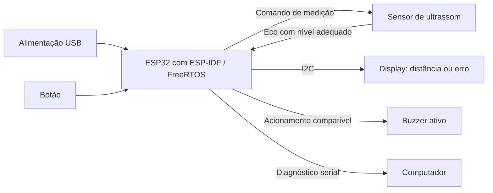

# Trena digital ultrassônica com ESP32 — plano de projeto

## 1. Equipe e objetivo

| Integrante | Nome completo | Matrícula |
| --- | --- | --- |
| 1 | A preencher | A preencher |
| 2 | A preencher | A preencher |
| 3 | A preencher | A preencher |
| 4 | A preencher | A preencher |

Estudar o **Velleman VTUSD3**, um medidor ultrassônico comercial, e propor uma reprodução parcial de sua função principal com ESP32: medir distância sob comando do usuário, apresentar o valor e indicar falhas.

O projeto considera quatro estudantes com pouca experiência em eletrônica. A montagem será em protoboard, alimentada por USB, sem mecanismos móveis ou circuitos de potência. “Rasp32” foi interpretado como ESP32, conforme o enunciado; confirmar o modelo da placa fornecida.

## 2. Produto estudado e recorte

O VTUSD3 é um instrumento portátil de medição de distâncias por ultrassom com apontador laser. A documentação do fabricante apresenta LCD, seleção de unidades, cálculo de área e volume e memória de medições [1][2]. O produto está descontinuado, mas dispõe de documentação pública e pode ser estudado historicamente.

O relatório deverá descrever público-alvo, contexto de uso, segmento e aplicações com fontes. Inserir foto do produto com legenda e origem; procurar imagem interna verificável, sem substituir o modelo por uma placa parecida.

| Função | Produto comercial | Reprodução prevista |
| --- | --- | --- |
| Medição de distância | Ultrassom [1][2] | Sensor de ultrassom disponível no laboratório |
| Solicitação de leitura | Tecla READ [2] | Um botão |
| Apresentação | LCD [2] | OLED I2C |
| Falhas de leitura | Função de alarme informada pelo fabricante [1] | Mensagem no display e aviso sonoro |
| Apontador | Laser [1][2] | Não reproduzido |
| Área e volume | Funções disponíveis [1][2] | Não reproduzidas |
| Memória de resultados | Função disponível [1][2] | Apenas resultado atual em RAM, sem histórico |
| Alimentação | Documentar a partir do manual [2] | USB da placa, conforme suas especificações |

A reprodução não terá equivalência comercial de alcance, precisão, autonomia ou robustez. O laser do original é apontador: não descrever o VTUSD3 como uma trena que mede por laser.

## 3. Escopo mínimo e critérios de conclusão

O protótipo futuro estará pronto quando conseguir:

1. Inicializar sem apresentar uma medida fictícia.
2. Receber um comando por toque, sem repetir a leitura indefinidamente com o botão pressionado.
3. Obter o tempo de eco sem permanecer bloqueado se o sensor não responder.
4. Calcular e validar a distância em uma faixa documentada.
5. Mostrar resultado com unidade ou erro explícito.
6. Emitir sinais sonoros curtos diferentes para sucesso e falha.
7. Repetir o ciclo após uma falha, sem precisar reiniciar.
8. Ter registros de verificação da lógica e do comportamento físico.

Ficam fora desse escopo: Wi-Fi, Bluetooth, aplicativos, serviços externos, laser, bateria própria, cartão SD, histórico persistente, cálculo de área/volume e compensação automática de temperatura. Primeiro demonstrar a função principal; não acrescentar esses recursos para tentar parecer mais original.

## 4. Materiais e confirmação do hardware

| Item | Quantidade | Situação | Verificar antes da montagem |
| --- | --- | --- | --- |
| ESP32 | 1 | Fornecimento informado pelo grupo | Modelo, pinagem, alimentação e pinos reservados |
| Protoboard | 1 | Fornecimento informado pelo grupo | Estado dos contatos e distribuição das linhas |
| Sensor de ultrassom | 1 | Consta como “Sensor Ultrasom” na lista | Modelo, alimentação, interface, faixa e temporização |
| Botão | 1 | Consta na lista | Terminais e configuração de entrada |
| OLED I2C | 1 | Consta como tela de 0.98 polegada | Controlador, resolução, endereço, alimentação e níveis lógicos |
| Buzzer ativo | 1 | Consta na lista | Tensão, corrente e circuito de acionamento |
| Cabo USB de dados | 1 | A confirmar | Compatibilidade com a placa |
| Jumpers e resistores | Conforme montagem | A confirmar | Valores para adaptação de níveis e demais ligações |
| Régua ou fita métrica e alvo plano | 1 conjunto | A providenciar para ensaio | Referência legível e alvo fixável |

O nome genérico do sensor não confirma um HC-SR04. Se esse for o módulo entregue, usar seu datasheet como referência e confirmar a variante real [3]. Não transpor parâmetros de um modelo para outro.

### Ligações conceituais

| Ligação | Finalidade | Condição |
| --- | --- | --- |
| ESP32 → entrada de comando do sensor | Solicitar a emissão | Conforme a interface do módulo |
| Saída de eco do sensor → ESP32 | Capturar duração do retorno | Adequar tensão antes da entrada quando necessário |
| Botão → entrada da ESP32 | Comando do usuário | Usar polarização definida e tratar repiques de contato |
| ESP32 ↔ display | Atualizar interface por I2C | Confirmar níveis de SDA/SCL, inclusive resistores do módulo |
| ESP32 → acionamento do buzzer | Aviso sonoro | Corrente compatível; usar driver se o módulo exigir |
| Alimentação e GND | Energizar e referenciar os circuitos | Compartilhar GND; respeitar a alimentação de cada módulo |

Não serão fixados números de GPIO antes de identificar a placa. Em um HC-SR04 convencional, a alimentação é de 5 V [3]; verificar o sinal ECHO e prever adaptação para a entrada de 3,3 V da ESP32. Não alimentar todo módulo com 3,3 V apenas para evitar um adaptador, nem aplicar 5 V diretamente ao GPIO.

Desligar a alimentação para mudar as ligações. Antes de energizar, revisar alimentação, GND, polaridades e ausência de curto com o professor ou responsável pelo laboratório.

## 5. Arquitetura conceitual

O diagrama expressa funções, não substitui o esquema elétrico. Não há conexão Wi-Fi prevista; o computador é usado para desenvolvimento e diagnóstico.

## 6. Lógica da medição

### Cálculo e unidades

A distância corresponde à metade do percurso do som, porque o pulso vai ao alvo e retorna ao sensor [3]. Usando segundos e metros por segundo:

`distancia_m = velocidade_som_m_s × tempo_eco_s / 2`

O firmware deverá converter explicitamente o tempo capturado para a unidade usada na fórmula. A velocidade adotada precisa estar documentada, pois varia com as condições ambientais. O exemplo do datasheet HC-SR04 usa 340 m/s [3]; com essa hipótese, 1.000 microssegundos correspondem a 0,17 m, ou 17 cm. Esse exemplo verifica a conversão matemática e não calibra o hardware.

A exibição terá unidade explícita. A quantidade de casas decimais deverá ser coerente com os ensaios: mostrar muitos dígitos não comprova precisão.

### Sequência de estados

| Estado | Comportamento | Próximo passo |
| --- | --- | --- |
| Inicialização | Configurar periféricos e mostrar “Pronto” | Aguardar botão se os componentes estiverem operacionais |
| Espera | Exibir mensagem inicial ou último resultado identificado como tal | Um novo toque inicia a medição |
| Medição | Mostrar “Medindo”, comandar sensor e aguardar eco com limite de tempo | Validar eco ou apresentar erro |
| Resultado válido | Exibir distância e confirmação sonora curta | Retornar à espera |
| Erro de medição | Exibir motivo compreensível e aviso sonoro distinto | Retornar à espera e permitir tentativa seguinte |
| Erro de inicialização | Registrar o periférico que falhou pelo diagnóstico disponível | Corrigir a causa; não anunciar que o instrumento está pronto |

No próximo comando, a interface deixa claro que a medida anterior não é o resultado da tentativa em curso. Não converter timeout, pulso ausente ou duração inválida em distância zero.

### Organização do software

Usar ESP-IDF, aproveitando drivers compatíveis com as versões escolhidas. Um único fluxo de aplicação pode tratar botão, medição, validação e interface; drivers podem utilizar interrupções ou periféricos para temporização. Não criar uma tarefa por componente sem necessidade.

Definir timeout, intervalo mínimo entre disparos e faixa válida conforme o sensor e as verificações de bancada. Não medir pulsos curtos apenas com atrasos de uma tarefa sem verificar a resolução temporal. Descrever o método de captura efetivamente adotado no relatório prático.

Uma falha de inicialização ou comunicação deve ser tratada. Para um buzzer com aviso curto, prever desligamento ao final do aviso. Não adicionar filtragem complexa antes de medir a estabilidade da leitura básica.

## 7. Roteiro da análise técnica exigida

Esta tabela organiza a pesquisa; não afirma características internas ainda desconhecidas do VTUSD3. A redação final deve cobrir **todos os subitens do enunciado**, com fonte junto a cada informação.

| Categoria | O que levantar no VTUSD3 | O que documentar na reprodução |
| --- | --- | --- |
| 1. Processamento | Fabricante/modelo, arquitetura, núcleos, clock e unidades dedicadas | Chip exato da placa fornecida e suas especificações |
| 2. Memória | RAM, ROM/Flash interna ou externa e EEPROM | RAM/Flash do chip e da placa; uso de RAM sem histórico persistente |
| 3. Sistema operacional | Tipo e versão, somente se houver evidência | ESP-IDF/FreeRTOS e versões escolhidas |
| 4. Sensores e atuadores | Sensor ultrassônico, apontador, sinalização e conexões verificáveis | Sensor real, botão, display, buzzer e ligações |
| 5. Comunicação com fio | Interfaces internas/externas identificáveis | Interface do sensor, I2C e diagnóstico serial da placa |
| 6. Comunicação sem fio | Presença ou ausência conforme fontes, sem inferir pelo aspecto | Não utilizada; distinguir capacidade do chip de recurso do projeto |
| 7. I/O | GPIO, ADC/DAC e PWM apenas quando identificados | GPIO e temporização; ADC/DAC e PWM não são requisitos do escopo mínimo |
| 8. Alimentação | Fonte, gerenciamento, economia, backup, reset e supervisores | USB, regulador da placa e proteções efetivamente presentes/configuradas |
| 9. Firmware | Evidências sobre firmware e atualização, incluindo OTA | Gravação por cabo; OTA fora do escopo |
| 10. Segurança | Criptografia, elemento seguro, secure boot e controles documentados | Recursos disponíveis versus habilitados; operação local |
| 11. Armazenamento externo | Presença/ausência e tipo, se identificado | Não previsto |
| 12. Interface | LCD, botões e demais formas de interação [2] | OLED, botão, sinalização sonora e mensagens de erro |

Para cada informação, guardar referência completa e página/seção usada. Se não houver evidência, escrever “não identificado nas fontes consultadas”, listando as consultas. “Não se aplica” exige justificativa; a falta de menção no manual não demonstra ausência.

Começar a pesquisa da placa interna cedo. O manual de operação pode não revelar processador e memória; procurar documentação técnica e desmontagens do modelo exato, sem comprar ou abrir um equipamento só para preencher a tabela.

Ao final, destacar como tecnologias críticas a emissão/recepção ultrassônica, a temporização do eco, o processamento da medida e a apresentação confiável do resultado. Separar análise do produto original e escolhas da reprodução.

## 8. Plano dos oito artigos científicos

Há uma [seleção inicial de oito artigos de revistas](ARTIGOS.md), com referências, links de PDF, resumos preliminares e situação de acesso: quatro tecnológicos e quatro de aplicações relacionadas. Nenhum foi identificado como estudo específico do VTUSD3. Confirmar se o professor aceita aplicações da categoria/tecnologia, resolver acessos e realizar leitura integral antes de fechar a bibliografia.

O roteiro abaixo foi atualizado para essa seleção; consulte o arquivo de artigos para os títulos completos e as limitações de cada entrada.

| Vaga | Tema de busca | Relação que o resumo deve explicar |
| --- | --- | --- |
| T1 | Revisão de métodos ultrassônicos | Princípios, sensores e limites |
| T2 | Influência ambiental | Erros e condições de ensaio |
| T3 | Interferência entre sensores | Confiabilidade da detecção de ecos |
| T4 | Distância pela atenuação de frequências | Comparar alternativas ao tempo de voo, sem implementá-las |
| A1 | Instrumento de distância com microcontrolador | Aplicação mais próxima da trena |
| A2 | Registro de distâncias em investigação de cena | Operação e utilidade da medição |
| A3 | Instrumento de medição de altura | Distância e referência geométrica |
| A4 | Localização ultrassônica interna | Uso ampliado de distâncias; confirmar adequação ao recorte |

Buscar por `ultrasonic ranging`, `airborne ultrasonic time of flight`, `ultrasonic distance measurement accuracy` e `portable distance measuring instrument`. Começar nas bases acadêmicas indicadas no enunciado. Não substituir artigos de revista por tutoriais, datasheets ou trabalhos de congresso.

Uma referência inicial é **Review of Ultrasonic Ranging Methods and Their Current Challenges**, *Micromachines*, 13(4), 520, 2022 [4]. Ela ajuda a localizar bibliografia, mas não comprova a arquitetura interna do VTUSD3 e não substitui os outros sete artigos.

Ficha mínima de cada artigo:

- Título, autores, revista, ano e DOI.
- Link do PDF original, sem enviar o PDF ao repositório.
- Problema estudado, método e resultados centrais em palavras próprias.
- Relação com o produto ou sua tecnologia e limites dessa relação.

Não afirmar que um estudo emprega o VTUSD3 quando aborda apenas medição ultrassônica. Se houver dificuldade para encontrar quatro aplicações adequadas, reavaliar os termos e o recorte durante a pesquisa, sem preencher com estudos de ultrassom médico sem relação com o instrumento.

## 9. Comparação com cinco outros produtos

Selecionar cinco medidores comerciais adicionais com manual ou página oficial. Preferir ao menos um outro ultrassônico; medidores a laser podem entrar como comparação de tecnologias, desde que a diferença fique explícita.

| Produto | Tecnologia de medição | Faixa e condições | Exatidão declarada | Funções e UI | Alimentação e comunicação | Fonte |
| --- | --- | --- | --- | --- | --- | --- |
| VTUSD3, produto estudado | Ultrassom [1][2] | A documentar | A documentar | A documentar | A documentar | [1][2] |
| Similar 1 | A selecionar | — | — | — | — | — |
| Similar 2 | A selecionar | — | — | — | — | — | — |
| Similar 3 | A selecionar | — | — | — | — | — | — |
| Similar 4 | A selecionar | — | — | — | — | — | — |
| Similar 5 | A selecionar | — | — | — | — | — | — |

Completar as categorias técnicas relevantes do enunciado quando existirem fontes. Comparar unidades e condições equivalentes; não confundir resolução do display, repetibilidade e exatidão. Não atribuir à reprodução a especificação de qualquer produto comparado.

## 10. Verificações do futuro protótipo

### Software

Quando houver implementação, deixar verificações pequenas para:

- Conversão do tempo para distância, incluindo o exemplo de 1.000 microssegundos e a velocidade escolhida.
- Rejeição de ausência de eco, timeout e duração inválida.
- Um toque produzir um comando e um botão mantido pressionado não repetir comandos sem liberação.
- Uma tentativa com erro não apresentar o valor anterior como novo resultado.

Essas verificações serão feitas com dados de teste; não precisam aquecer, movimentar ou modificar o sensor real para produzir cada condição.

### Bancada

| Ensaio | Procedimento | Critério |
| --- | --- | --- |
| Inicialização | Ligar e reiniciar a placa | Mostrar estado inicial sem medida inventada |
| Comando | Pressionar e manter o botão | Uma medição por toque completo |
| Medidas conhecidas | Coletar dez leituras a 20, 50 e 100 cm, se compatíveis com o módulo | Registrar todas as leituras e comparar com a referência |
| Ausência de retorno | Usar uma situação sem eco válido dentro do timeout | Mostrar erro e continuar aceitando comandos |
| Recuperação | Restaurar um alvo válido após uma falha | Voltar a medir sem reiniciar |
| Interface | Executar sucesso e falha | Mostrar unidade/mensagem e distinguir os avisos sonoros |
| Limitações do alvo | Comparar alvo plano com inclinação ou material diferente | Registrar efeito observado, sem prometer compensação |

Fixar a face de referência do sensor e medir a distância até o plano do alvo. Documentar alinhamento, alvo, ambiente, régua usada e eventual diferença geométrica entre o transdutor e a referência adotada.

Para cada distância, registrar média, menor e maior leitura, número de falhas e erro entre a média e a referência. A faixa de erro aceitável será definida após identificar o sensor e seu uso didático, antes do ensaio de aceitação. A régua também tem incerteza; não alegar calibração profissional.

Não apagar leituras ruins para melhorar a média: registrar as falhas e explicar exclusões justificadas. Para o Trabalho 2, apresentar este procedimento como plano, sem preencher a tabela com resultados fictícios.

## 11. Divisão e sequência de trabalho

| Integrante | Entrega principal | Pesquisa acadêmica |
| --- | --- | --- |
| 1 | Descrição, imagens com fonte e tabela dos cinco similares | T1 e A1 |
| 2 | Análise de processamento, memória, SO, firmware e segurança do original | T2 e A2 |
| 3 | Sensores, interfaces, I/O, alimentação e proposta de ligação | T3 e A3 |
| 4 | Equivalências ESP32, diagrama, fluxo, testes e limitações | T4 e A4 |

Cada integrante inclui as fontes de sua parte. A revisão final é conjunta: conferir consistência, referências e entendimento do funcionamento por todos.

### Trabalho 2: entrega teórica

| Data sugerida | Resultado concreto |
| --- | --- |
| 29/10/2026 | Preencher equipe, confirmar tema e registrar quais módulos serão fornecidos |
| 30/10/2026 | Ler manual, iniciar análise interna e selecionar artigos e produtos com fontes |
| 31/10/2026 | Redigir descrição e análise técnica; revisar cada subitem do enunciado |
| 01/11/2026 | Completar resumos, comparação, proposta e diagrama |
| 02/11/2026 | Revisar em grupo imagens, links, referências, originalidade e Markdown |
| 03/11/2026 | Conferir identificação e submissão conforme a disciplina |

O enunciado registra 03/11/2026; confirmar o horário limite e o procedimento de MR. A execução física não deve bloquear a entrega conceitual.

### Trabalho Final: construção posterior

1. Identificar a placa e os módulos; desenhar e revisar as ligações.
2. Configurar ESP-IDF e verificar gravação/diagnóstico da placa.
3. Ler o sensor e conferir os valores no monitor serial.
4. Integrar o botão e o tratamento de uma solicitação por toque.
5. Integrar display, buzzer e mensagens de falha.
6. Executar as verificações de software e bancada.
7. Registrar montagem, versões, resultados e limitações observadas.

Passar à próxima etapa após verificar a anterior; isso facilita encontrar erros sem integrar todos os componentes de uma vez.

## 12. Checklist do relatório final

- [ ] Nomes completos e matrículas dos quatro integrantes.
- [ ] Descrição do VTUSD3, funções, público-alvo e aplicações.
- [ ] Fotos e ilustrações com fonte; imagem interna se disponível.
- [ ] Todos os subitens das 12 categorias técnicas preenchidos ou explicitamente justificados.
- [ ] Fonte junto a cada característica e bibliografia completa ao final.
- [ ] Separação entre fatos do original, hipóteses e escolhas da reprodução.
- [ ] Tecnologias críticas destacadas.
- [ ] Mapeamento entre o produto e ESP32/componentes disponíveis.
- [ ] Diagrama e limitações da reprodução parcial.
- [ ] Oito artigos distintos de revistas, com resumos e links dos PDFs originais.
- [ ] Cinco outros produtos comerciais comparados com fontes.
- [ ] Nenhum resultado de ensaio apresentado antes de sua realização.
- [ ] Texto e diagramas próprios; referências ao acervo se ele for utilizado.
- [ ] README principal na pasta do produto, links e imagens renderizados no GitLab.
- [ ] Revisão final da entrega e submissão conforme o enunciado.

## Referências iniciais

[1] VELLEMAN. **VTUSD3: Ultrasonic Distance Meter + Laser**. Página oficial. Disponível em: https://www.velleman.eu/products/view/ultrasonic-distance-meter-laser-vtusd3/?id=372828&lang=en. Consultada na pesquisa inicial em: 29 out. 2026.

[2] VELLEMAN. **VTUSD3 — User Manual**. Versão 03, 25 out. 2018. Inclui seção em português. Disponível em: https://cdn.velleman.eu/downloads/1/vtusd3a6v03.pdf. Consultado na pesquisa inicial em: 29 out. 2026.

[3] ELECFREAKS. **Ultrasonic Ranging Module HC-SR04**. Datasheet disponibilizado pela SparkFun. Disponível em: https://cdn.sparkfun.com/datasheets/Sensors/Proximity/HCSR04.pdf. Consultado na pesquisa inicial em: 29 out. 2026. Aplicável à reprodução somente se confirmado esse modelo e sua compatibilidade com o módulo real.

[4] QIU, Zurong; LU, Yaohuan; QIU, Zhen. **Review of Ultrasonic Ranging Methods and Their Current Challenges**. *Micromachines*, v. 13, n. 4, art. 520, 2022. DOI: https://doi.org/10.3390/mi13040520. Página: https://www.mdpi.com/2072-666X/13/4/520. Texto integral: https://pmc.ncbi.nlm.nih.gov/articles/PMC9025471/. Ver a [seleção comentada](ARTIGOS.md) para as oito referências e pendências de leitura.

[5] Enunciado e lista de componentes da disciplina: [Trabalho 2 — 2026/2](../README.md) e [Lista de Sensores](../Lista_de_Sensores.md).
